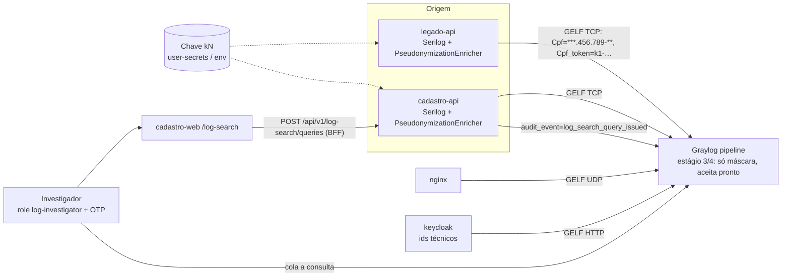

# Plano técnico — Spec 001 Pseudonimização pesquisável de dados pessoais nos logs

## 0. Conformidade com a Constituição

| Artigo | Status | Como |
|---|---|---|
| I — Idioma | ✅ | Campos/rotas/classes em inglês (`Cpf_token`, `/api/v1/log-search/queries`, `LogPseudonymizer`); comentários e textos de tela em PT-BR |
| II — Simplicidade | ✅ | Sem serviço novo: HMAC do BCL na origem; endpoint no Cadastro existente; Graylog só com máscara |
| III — Arquitetura | ✅ | Cadastro: porta na Application, HMAC na Infrastructure, enricher e endpoint na Api; legado: enricher em `Api/Common` |
| IV — Segurança | ✅ | Chave fora do repo (user-secrets/env), role + OTP, antiforgery, rate limit, POST sem valor em URL, auditoria sem o valor |
| V — Testes | ✅ | Vetores comuns, unitários, integração (GELF capturado), smoke do pipeline, E2E da tela |
| VI — Observabilidade | ✅ | Cadastro passa a enviar GELF com `trace_id`; stream de auditoria |
| VII — Confiabilidade | ✅ | Enricher sem I/O; falha de configuração = fail fast na subida |
| VIII — Dados | ✅ | Sem banco novo; logs antigos não são reprocessados |
| IX — Contratos | ✅ | `/api/v1`, OpenAPI, Problem Details; campos GELF só somados (`*_token`), nenhum removido |
| X — Fluxo | ✅ | Branch `DEV-004` em cada repo; um PR por tarefa |
| XI — Conduta | ✅ | Funções do Graylog conferidas no código-fonte 7.2; Serilog/Keycloak a conferir via Context7 nas tarefas |

## 1. Visão da solução

## 2. Algoritmo comum (legado e cadastro)

| Tipo | Listas de campo (mesmas do `provision.sh`) | Domínio | Canônico (válido se) | Máscara (ADR-0002) |
|---|---|---|---|---|
| CPF | `cpf Cpf CPF` | `cpf` | só dígitos, 11 | `***.456.789-**` |
| CNPJ | `cnpj Cnpj CNPJ` | `cnpj` | `trim`, remove `./-`, maiúsculas, `[0-9A-Z]{12}[0-9]{2}` | `12.3**.***/***1-90` |
| Telefone | `phone Phone mobilePhone MobilePhone mobile_phone celular Celular telefone Telefone` | `phone` | só dígitos ASCII; tira `55` inicial se ≥ 12 dígitos; 10–11 dígitos | `11*****4321` (fixo também com 5 asteriscos) |
| Login/e-mail | `username user_name UserName Username login Login preferred_username email Email` | `login` | `trim` + `ToLowerInvariant`; ≥ 4 caracteres e não começa com `@` | `mar***` / `ana***@gmail`: até 3 caracteres da parte local (1 se ela tiver até 3) + `***`; com `@`, soma `@` + rótulo do domínio até o primeiro `.` |

CPF: remove todo caractere que não é dígito ASCII. Regras conferidas com `PersonalDataMasker` do legado (L01); o
cadastro (C02) DEVE reproduzi-las exatamente.

`token = "k" + id + "-" + hex(HMAC-SHA256(key, domínio + "|" + canônico))[0..32]` (hex minúsculo).
Fora do formato: campo = `***`, sem token. Na origem o texto é renderizado das propriedades já trocadas, então também
sai com `***`. Na rede de segurança do Graylog vale a regra do ADR-0002 (estágio 3): o valor fora do formato é trocado
por `***` nos textos, exceto o curto (login < 4 caracteres; CPF/telefone < 8 dígitos, CNPJ < 8 caracteres alfanuméricos).
Campos aninhados (`{@Obj}`, dicionários, listas) recebem só a máscara dentro do objeto (GELF `_Obj.Email`, gravado
pelo Graylog como `Obj_Email`). O token vai como propriedade de topo com o caminho unido por `_` (`Obj_Email_token`,
`People_0_login_token`), para nunca entrar no texto renderizado. A pesquisa padrão só usa campos de topo.

**Vetores de teste obrigatórios** (chave `k1` = bytes `00 01 02 … 1f`, base64 `AAECAwQFBgcICQoLDA0ODxAREhMUFRYXGBkaGxwdHh8=`;
calculados com `openssl dgst -sha256 -mac HMAC`):

| Entrada (antes do canônico) | Mensagem HMAC | Token |
|---|---|---|
| CPF `123.456.789-09` | `cpf\|12345678909` | `k1-b81c27bb5f38080e6ca0ed38b828f262` |
| CNPJ `12.345.678/0001-90` | `cnpj\|12345678000190` | `k1-f528c9e51a504dbaf6a9f245ba2cea10` |
| Telefone `+55 (11) 98765-4321` | `phone\|11987654321` | `k1-412838d1c85d64c0ed202ae3b1546615` |
| Login ` Maria.Silva ` | `login\|maria.silva` | `k1-c5b5c3feef6c408ecea5b17d95af9793` |
| E-mail `Ana.Souza@Gmail.com` | `login\|ana.souza@gmail.com` | `k1-c362504bb56a3e35cc245073244c3da6` |

Estes vetores entram como teste em legado, cadastro (enricher e endpoint) e no script local.

## 3. Componentes afetados

### legado (.NET 10)

| Item | Mudança |
|---|---|
| `Legado.Api/Common/Pseudonymization/` (novo) | `PersonalDataMasker` (máscaras + canônico, puro), `PseudonymTokenGenerator` (HMAC, chaves das opções), `PseudonymizationOptions` (`CurrentKeyId`, `Keys`, validação na subida com `ValidateOnStart`), `PseudonymizationEnricher` (`ILogEventEnricher`: substitui propriedade pela máscara via `AddOrUpdateProperty` e soma `<Campo>_token`) |
| `Common/LoggingSetup.cs` | `.Enrich.With<PseudonymizationEnricher>()` **antes** dos sinks; preserva as mudanças não commitadas de documentação LGPD |
| `ClientLogs/ClientLogEndpoints.cs` | `***@***` → máscara do ADR-0002 via `PersonalDataMasker`; `ClientSource` sem query string/fragmento e mascarado |
| Config | `Logging:Pseudonymization:*` em user-secrets (dev) e env; `.env.example` só com o nome da variável |

Conferir na tarefa (Context7): ordem enricher × renderização do `message` no `Serilog.Sinks.Graylog` 3.1.1 e se
`full_message` usa o texto renderizado.

### cadastro (.NET 10 + Angular 22)

| Item | Mudança |
|---|---|
| Logging (novo) | Serilog + `Serilog.Sinks.Graylog` (GELF TCP, mesmo padrão do `LoggingSetup` do legado: `service_name=cadastro-api`, `TraceContextEnricher`), fallback console; health não muda |
| `Cadastro.Application/LogSearch/` | `GetLogSearchQuery` (record), `GetLogSearchQueryHandler` (`sealed internal`), porta `ILogPseudonymizer` (`Mask`, `Tokenize` com todas as chaves), `LogSearchDataType` (enum), DTO `LogSearchQueryDto` |
| `Cadastro.Infrastructure/Logging/` | `LogPseudonymizer` (HMAC + canônico + máscara; mesma especificação do legado), `PseudonymizationOptions` |
| `Cadastro.Api/Logging/` | `PseudonymizationEnricher` usando `ILogPseudonymizer` |
| `Cadastro.Api/LogSearch/LogSearchEndpoints.cs` | `POST /api/v1/log-search/queries`, policy `logs:investigate` (`RequireRole("log-investigator")`), antiforgery, rate limit `log-search` (30/h por `sub`), log de auditoria |
| `cadastro-frontend/src/app/log-search/` | Página standalone/OnPush/Signals, rota `/log-search` com guard de role, item de menu condicionado à role |
| `scripts/log-search-token.sh` | Só dev: lê `LOG_PSEUDONYMIZATION_KEY_K*` do `.env`, imprime tokens e consulta (`openssl`) |
| `scripts/generate-env.sh` / `.env.example` | Gera `k1` local (mesmo valor deve ir para o user-secrets do legado — instrução no README) |
| `ClientLogs/ClientLogEndpoints.cs` | Igual ao legado (máscara do ADR-0002, `ClientSource` sem query string e mascarado) |

### keycloak

| Item | Mudança |
|---|---|
| `realm/realm-workspace.json` | Realm role `log-investigator` ("Investigação em logs: gera consultas por token; OTP obrigatório"); `cadastro` recebe a role no escopo; nenhuma atribuição padrão |
| Fluxo `workspace-browser` | OTP condicional também para `log-investigator` (mecanismo a confirmar na doc do Keycloak 26 via Context7: segunda condição de role ou role composta que exige OTP) |
| `provisioning/provision.sh` | Reconciliação idempotente da role e do fluxo |

### graylog

| Item | Mudança |
|---|---|
| `rules/templates/lgpd-*.rule.tmpl` | Valor já no formato de máscara → inalterado; campos `*_token` nunca tocados; troca nos textos **só** quando a máscara é válida (nunca com `***`) e login ≥ 4 caracteres |
| `provision.sh` | `LGPD_TEXT_FIELDS` + `ClientSource`, `RequestPath`, `case_reference` e campos de URL do nginx (`http_path` e outros que o extractor criar — levantar); comentário do Cadastro conforme a realidade após C01; `ensure_rule` imprime o corpo do 400; stream `Cadastro - Pesquisa em logs (LGPD)` (`audit_event:log_search_query_issued`) |
| `scripts/smoke-test.sh` | Um caso por formato e por campo afirmado nos ADRs; máscara/token prontos preservados; valor curto não corrompe texto; `ClientSource`/`RequestPath`; auditoria no stream |
| `README.md`, `CLAUDE.md` | Só o que o smoke comprova; referência ao ADR-0003; preservar a nota `MSYS_NO_PATHCONV` já não commitada |

## 4. Contratos

### Cadastro — `POST /api/v1/log-search/queries`

| Campo | Regra |
|---|---|
| `dataType` | `cpf` \| `cnpj` \| `phone` \| `email` \| `login` |
| `value` | Obrigatório; validado pelo canônico do tipo |
| `caseReference` | Obrigatório; `^[A-Za-z0-9._/-]{3,40}$` |

Respostas: 200 `{ dataType, tokens: [{ keyId, token }], graylogQuery }` · 400 Problem Details com `errors` por campo
(sem eco do valor) · 401 · 403 · 429 · antiforgery inválido 400.
`graylogQuery` = OR de `<campo>_token:("tok1" OR "tok2")` para cada nome de campo do tipo (`email` e `login` usam a
mesma lista). As listas ficam em `LogSearchFields` (código) com teste que compara com as listas do ADR-0002.

### Campos GELF novos

| Campo | Origem | Exemplo |
|---|---|---|
| `<Campo>_token` | legado, cadastro | `Cpf_token=k1-b81c27bb5f38080e6ca0ed38b828f262` |
| `audit_event`, `investigator_id`, `data_type`, `case_reference`, `tokens` | cadastro (pesquisa) | `log_search_query_issued`, `sub` do Keycloak, `cpf`, `INC-1234`, `k1-…` |

## 5. Segurança (STRIDE resumido)

| Ameaça | Mitigação |
|---|---|
| Spoofing do investigador | Keycloak + OTP; BFF com cookie `Secure`/`HttpOnly`; antiforgery |
| Repudiation | Auditoria por pesquisa (inclui 403) com `investigator_id` e `trace_id` |
| Information disclosure (oráculo) | Role dedicada, rate limit 30/h, motivo obrigatório; valor nunca em URL/log/estado do front |
| Information disclosure (chave) | Só em user-secrets/env das duas APIs; nunca no Graylog/Keycloak/imagem; rotação anual; destruição após 30 dias |
| Tampering de log | Inputs GELF sem autenticação (já documentado no CLAUDE.md do graylog; mTLS em produção) |
| Elevation | Role sem atribuição padrão; conta de serviço do Cadastro não recebe a role |

## 6. Observabilidade

- Novo stream `Cadastro - Pesquisa em logs (LGPD)`; alerta opcional: > 10 pesquisas de um mesmo `investigator_id` em
  10 min (`NOT smoke_test:true`).
- Métrica de quantos eventos chegam ao Graylog com campo `LGPD_*` **sem** `*_token` vindos de legado/cadastro (sinal
  de origem não adaptada): busca salva no README.

## 7. Estratégia de testes

| Nível | O quê |
|---|---|
| Unitário | Masker e gerador (vetores da §2, canônicos, inválidos, domínio comum e-mail/login, duas chaves); enricher (substitui, soma token, ignora campos fora da lista, propriedades aninhadas/destructured); handler (validação, OR das chaves e campos); componente Angular (4 estados, sem valor em URL/estado após sucesso) |
| Integração | Legado/cadastro: sink GELF capturado (servidor TCP fake ou `InMemorySink` + formatter GELF) prova que nenhum campo contém os valores de entrada; endpoint com `WebApplicationFactory`: 200/400/401/403/429, antiforgery, auditoria sem o valor |
| Keycloak | `WorkspaceRealmIT`: role existe, sem default, OTP exigido para a role |
| Pipeline | `smoke-test.sh`: um caso por formato/campo, preservação de máscara/token, valor curto, `ClientSource`/`RequestPath`, stream de auditoria |
| E2E | Playwright na tela `/log-search` (mobile/tablet/desktop, axe, 403) |

## 8. Riscos

| Risco | Mitigação |
|---|---|
| Algoritmo divergir entre legado e cadastro | Vetores comuns da §2 nos dois; smoke cruzado no X01 |
| Enricher rodar depois da renderização ou não cobrir objetos destructured | Teste de integração com GELF real; conferir doc do sink |
| Pipeline transformar máscara pronta em `***` | G01 antes de L01/C02 chegarem ao Graylog compartilhado; smoke |
| Conflito com o debugger nos arquivos do graylog | Onda do graylog só começa após o debugger entregar |
| Mudanças não commitadas em LoggingSetup/CLAUDE.md | Tarefas partem do working tree atual e preservam essas mudanças |
| Chave dev copiada entre repos divergir | Script local e README instruem; teste de subida falha sem chave |

## 9. Decisões (ADRs)

- ADR-0003 (graylog) — aceito. Ao implementar, o ADR-0003 do legado (logs no Graylog) e o ADR-0007 do keycloak recebem
  referência cruzada na tarefa X01.
